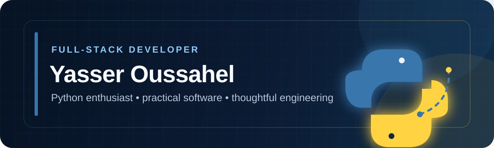
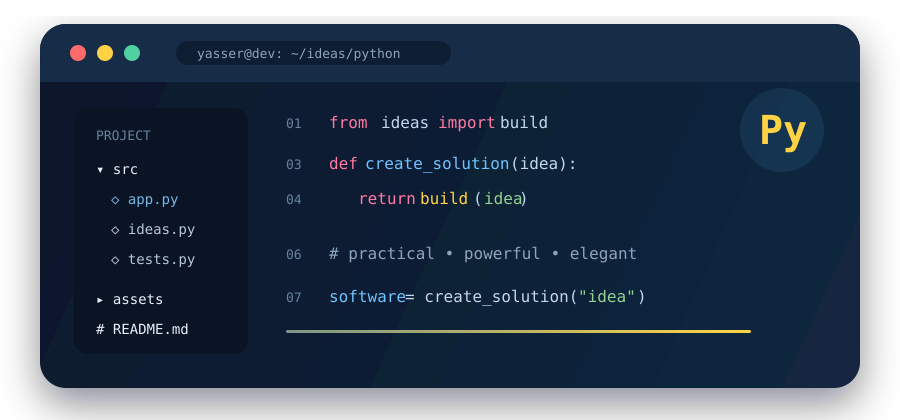

  <a href="./README.md">🇬🇧 Read in English</a>

  
    
  

  
  
  
  

## À propos de moi

Je suis **Yasser Oussahel**, développeur full-stack basé au **Maroc 🇲🇦**. J’aime transformer des idées en applications utiles, soignées et faciles à maintenir. Je suis titulaire d’un **Bac+3 — Licence Professionnelle en Développement Informatique**, complété par une formation en **Développement Web et Mobile**.

Mon objectif est de progresser en tant que développeur logiciel, de renforcer mes compétences et de contribuer à des projets innovants qui créent une vraie valeur. Je suis actuellement **ouvert aux postes de développeur junior et aux opportunités de stage**.

- 🐍 Python est mon langage préféré et occupe une place centrale dans mon parcours.
- 🧩 J’apprécie le développement full-stack, les interfaces claires et la résolution de problèmes concrets.
- 🌱 Je développe continuellement mes compétences en backend, bases de données, tests et déploiement.
- 🤝 J’accorde de l’importance à la curiosité, à la communication et à l’amélioration continue.

 

> [!IMPORTANT]
> **« J’aime Python et programmer avec Python. J’aime transformer des idées en solutions logicielles puissantes, pratiques et élégantes. »**

## Python avant tout 🐍

  
    
  <em>Une syntaxe lisible, un écosystème riche et des possibilités infinies — de l’automatisation aux applications web.</em>

## Boîte à outils technique

<table>
  <tr><td align="center" width="22%"><strong>Langages</strong></td><td>    </td></tr>
  <tr><td align="center"><strong>Frontend</strong></td><td>   </td></tr>
  <tr><td align="center"><strong>Backend</strong></td><td>   </td></tr>
  <tr><td align="center"><strong>Mobile</strong></td><td></td></tr>
  <tr><td align="center"><strong>Données & ORM</strong></td><td>    </td></tr>
  <tr><td align="center"><strong>Outils</strong></td><td>    </td></tr>
</table>

## Projets à la une

### ⭐ RankPilot — Auditeur SEO Python & Django

Mon projet Python phare : une application bilingue d’audit SEO qui analyse les sites web, détecte les problèmes courants, vérifie les liens internes et génère des rapports CSV.

    

<table>
  <tr>
    <td width="50%" valign="top"><h3>AgencyFlow</h3>
Un système bilingue de gestion d’agence de marketing digital pour organiser clients, campagnes, employés et tâches.

  
<a href="https://github.com/yasser-dev-code/AgencyFlow">Découvrir AgencyFlow →</a></td>
    <td width="50%" valign="top"><h3>Small Business Website CMS</h3>
Un CMS MERN complet avec site public responsive et tableau de bord sécurisé par JWT pour gérer le contenu d’une entreprise.

   
<a href="https://github.com/yasser-dev-code/small-business-website-cms">Découvrir le CMS →</a></td>
  </tr>
  <tr>
    <td width="50%" valign="top"><h3>ClientFlow</h3>
Un système Laravel de gestion des clients et des projets, conçu pour centraliser les relations commerciales et le travail.

  
<a href="https://github.com/yasser-dev-code/ClientFlow">Découvrir ClientFlow →</a></td>
    <td width="50%" valign="top"><h3>Banque-En-Ligne</h3>
Une application bancaire Java Swing basée sur MVC et la POO, avec comptes, virements, historique et relevés.

  
<a href="https://github.com/yasser-dev-code/Banque-En-Ligne">Découvrir Banque-En-Ligne →</a></td>
  </tr>
</table>

## Activité GitHub

  <picture><source media="(prefers-color-scheme: dark)" srcset="https://github-readme-stats.vercel.app/api?username=yasser-dev-code&show_icons=true&hide_border=true&bg_color=00000000&title_color=FFD343&icon_color=3776AB&text_color=C9D1D9&ring_color=3776AB" /></picture>
  <picture><source media="(prefers-color-scheme: dark)" srcset="https://github-readme-stats.vercel.app/api/top-langs/?username=yasser-dev-code&layout=compact&hide_border=true&bg_color=00000000&title_color=FFD343&text_color=C9D1D9&langs_count=8" /></picture>
   
  <picture><source media="(prefers-color-scheme: dark)" srcset="https://streak-stats.demolab.com?user=yasser-dev-code&hide_border=true&background=00000000&ring=3776AB&fire=FFD343&currStreakLabel=FFD343&sideLabels=C9D1D9&dates=8B949E&currStreakNum=FFFFFF&sideNums=FFFFFF" /></picture>
   
  <picture><source media="(prefers-color-scheme: dark)" srcset="https://github-readme-activity-graph.vercel.app/graph?username=yasser-dev-code&bg_color=00000000&color=C9D1D9&line=3776AB&point=FFD343&area=true&area_color=3776AB&hide_border=true" /></picture>

### Contributions en mouvement

<picture><source media="(prefers-color-scheme: dark)" srcset="https://raw.githubusercontent.com/yasser-dev-code/yasser-dev-code/output/github-contribution-grid-snake-dark.svg" /></picture>

## Construisons quelque chose d’utile

Je recherche des **postes de développeur junior, des stages et des projets collaboratifs** où je pourrai apprendre, contribuer et transformer de bonnes idées en logiciels fiables.

 

Conçu avec soin, nourri par la curiosité et animé par l’esprit Python. 🐍

