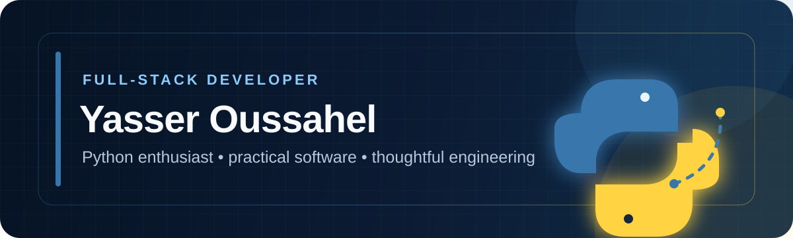
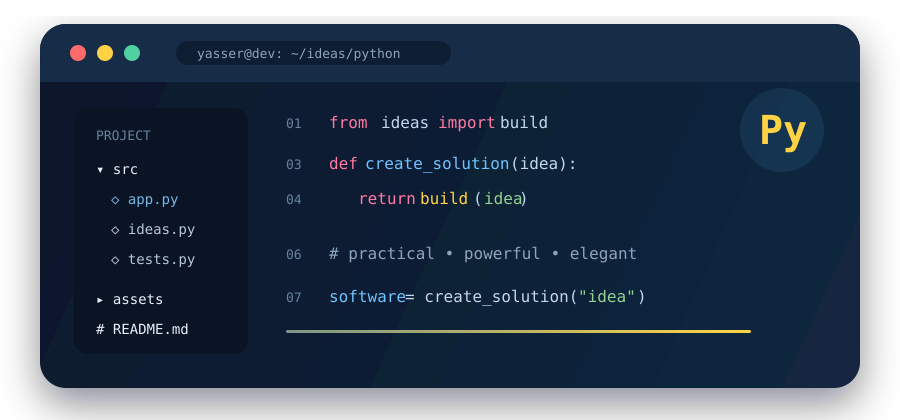

  <a href="./README.fr.md">🇫🇷 Lire en français</a>

  
    
  

  
  
  
  

## About me

I am **Yasser Oussahel**, a full-stack developer from **Morocco 🇲🇦** who enjoys transforming ideas into useful, maintainable applications. I hold a **Bac+3 — Licence Professionnelle en Développement Informatique**, complemented by additional training in **Web and Mobile Development**.

My goal is to keep growing as a software developer, deepen my craft, and contribute to innovative projects with real-world value. I am currently **open to junior developer positions and internship opportunities**.

- 🐍 Python is my favorite language and the center of my learning journey.
- 🧩 I enjoy full-stack development, clean interfaces, and practical problem-solving.
- 🌱 I am strengthening my backend, database, testing, and deployment skills.
- 🤝 I value curiosity, clear communication, and continuous improvement.

 

> [!IMPORTANT]
> **“I love Python and coding with Python. I enjoy turning ideas into powerful, practical and elegant software solutions.”**

## Python first 🐍

  
    
  <em>Readable syntax, a rich ecosystem, and endless possibilities — from automation to web applications.</em>

## Technology toolbox

<table>
  <tr>
    <td align="center" width="22%"><strong>Languages</strong></td>
    <td>
      
      
      
      
      
    </td>
  </tr>
  <tr>
    <td align="center"><strong>Frontend</strong></td>
    <td>
      
      
      
      
    </td>
  </tr>
  <tr>
    <td align="center"><strong>Backend</strong></td>
    <td>
      
      
      
      
    </td>
  </tr>
  <tr>
    <td align="center"><strong>Mobile</strong></td>
    <td></td>
  </tr>
  <tr>
    <td align="center"><strong>Data & ORM</strong></td>
    <td>
      
      
      
      
      
    </td>
  </tr>
  <tr>
    <td align="center"><strong>Tools</strong></td>
    <td>
      
      
      
      
      
    </td>
  </tr>
</table>

## Featured projects

### ⭐ RankPilot — Python & Django SEO Auditor

  

My featured Python project: a bilingual SEO auditing application that analyzes websites, detects common SEO issues, checks internal links, and generates CSV reports.

  
  
  
  
  

<table>
  <tr>
    <td width="50%" valign="top">
      
      <h3>AgencyFlow</h3>
      
A bilingual digital marketing agency management system for organizing clients, campaigns, employees, and tasks.

      
  

      <a href="https://github.com/yasser-dev-code/AgencyFlow">Explore AgencyFlow →</a>
    </td>
    <td width="50%" valign="top">
      
      <h3>Small Business Website CMS</h3>
      
A full-stack MERN CMS with a responsive public website and a JWT-secured dashboard for managing business content.

      
   

      <a href="https://github.com/yasser-dev-code/small-business-website-cms">Explore the CMS →</a>
    </td>
  </tr>
  <tr>
    <td width="50%" valign="top">
      
      <h3>ClientFlow</h3>
      
A Laravel client and project management system designed to keep business relationships and work organized.

      
  

      <a href="https://github.com/yasser-dev-code/ClientFlow">Explore ClientFlow →</a>
    </td>
    <td width="50%" valign="top">
      
      <h3>Banque-En-Ligne</h3>
      
A Java Swing banking application built with MVC and OOP, including account management, transfers, history, and statements.

      
  

      <a href="https://github.com/yasser-dev-code/Banque-En-Ligne">Explore Banque-En-Ligne →</a>
    </td>
  </tr>
</table>

## GitHub activity

  <picture>
    <source media="(prefers-color-scheme: dark)" srcset="https://github-readme-stats.vercel.app/api?username=yasser-dev-code&show_icons=true&hide_border=true&bg_color=00000000&title_color=FFD343&icon_color=3776AB&text_color=C9D1D9&ring_color=3776AB" />
    
  </picture>
  <picture>
    <source media="(prefers-color-scheme: dark)" srcset="https://github-readme-stats.vercel.app/api/top-langs/?username=yasser-dev-code&layout=compact&hide_border=true&bg_color=00000000&title_color=FFD343&text_color=C9D1D9&langs_count=8" />
    
  </picture>
   
  <picture>
    <source media="(prefers-color-scheme: dark)" srcset="https://streak-stats.demolab.com?user=yasser-dev-code&hide_border=true&background=00000000&ring=3776AB&fire=FFD343&currStreakLabel=FFD343&sideLabels=C9D1D9&dates=8B949E&currStreakNum=FFFFFF&sideNums=FFFFFF" />
    
  </picture>
   
  <picture>
    <source media="(prefers-color-scheme: dark)" srcset="https://github-readme-activity-graph.vercel.app/graph?username=yasser-dev-code&bg_color=00000000&color=C9D1D9&line=3776AB&point=FFD343&area=true&area_color=3776AB&hide_border=true" />
    
  </picture>

### Contributions in motion

<picture>
  <source media="(prefers-color-scheme: dark)" srcset="https://raw.githubusercontent.com/yasser-dev-code/yasser-dev-code/output/github-contribution-grid-snake-dark.svg" />
  
</picture>

## Let’s build something useful

I am interested in **junior software development roles, internships, and collaborative projects** where I can learn, contribute, and turn good ideas into dependable software.

  
  

  Designed with care, powered by curiosity, and written with a little Python spirit. 🐍

